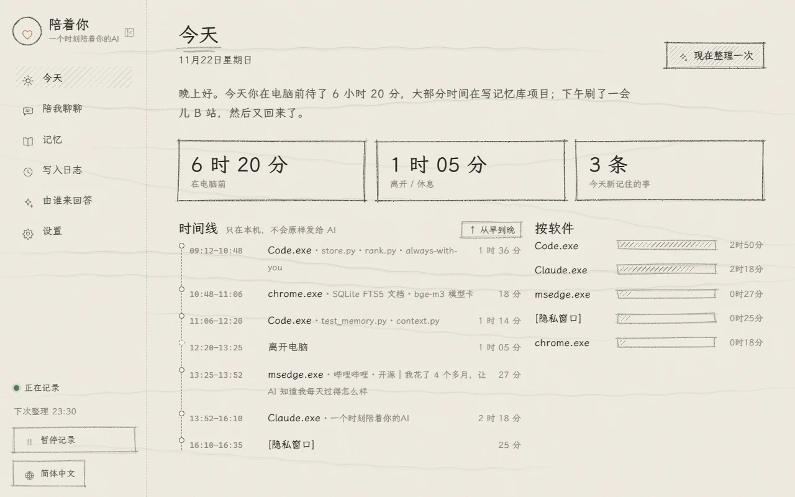
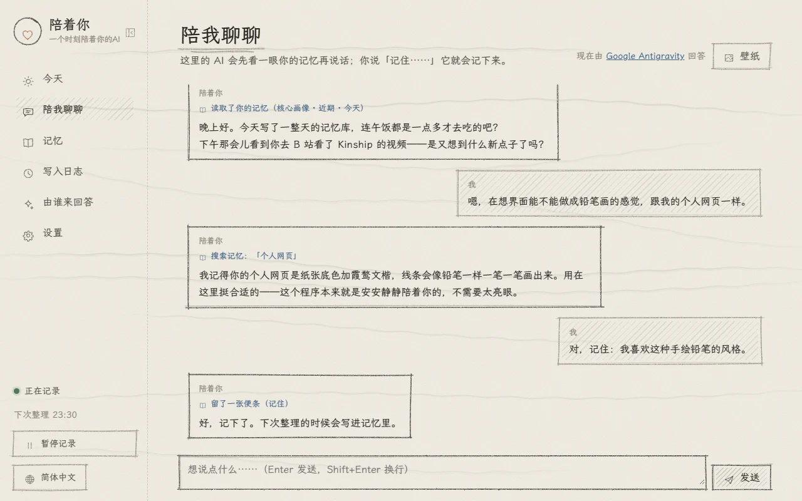
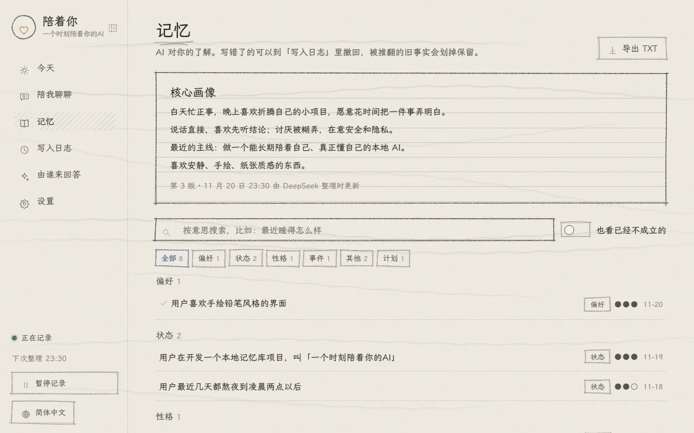
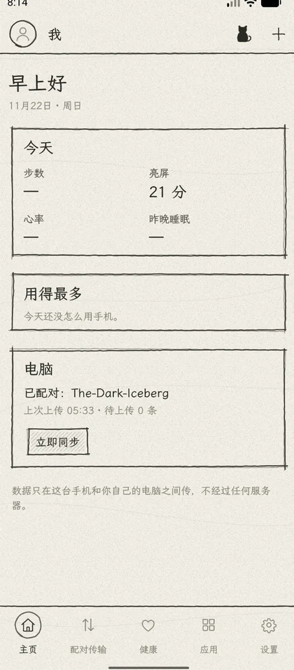
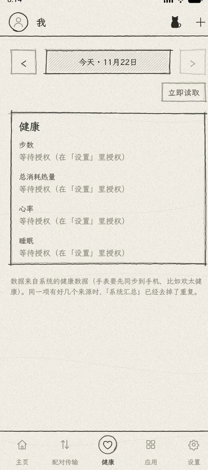
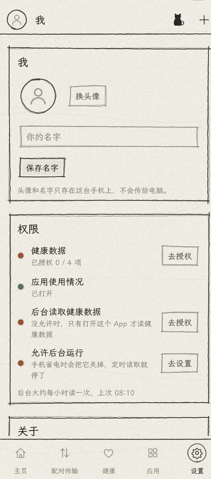
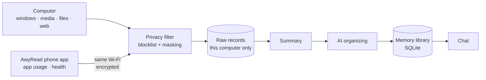

<div align="center">


# Always With You

**一个时刻陪着你的AI** · A personal memory library that runs only on your own computer

Records your day on your computer and phone → filters out private things → lets an AI organize it into "memories about you" → when you want to chat, it already knows how you've been.

    

**English** · [简体中文](README.md)

</div>

---

## What it looks like

<table>
<tr>
<td width="50%"><br><sub>Today: what you did at the computer (stays on this computer)</sub></td>
<td width="50%"><br><sub>Chat: it reads your memories before answering</sub></td>
</tr>
<tr>
<td colspan="2"><br><sub>Memory: your core profile and individual facts; anything wrong can be undone</sub></td>
</tr>
</table>

<p align="center">
&nbsp;
&nbsp;

<br><sub>AwyRead phone app: Home / Health / Settings (screenshots from the emulator)</sub>
</p>

> The screenshots show demo data, not real records. The interface is available in Simplified Chinese and English.

## What it does

| | |
|---|---|
| **Remembers** | Computer: the window in front, time away / asleep, what's playing, recently opened files, and with the browser extension, the pages you visit. Phone: how long you used each app, screen-on time, steps, heart rate, sleep. |
| **Organizes** | A few times a day, a *summary* of that period goes to an AI (DeepSeek or a subscription AI) that turns it into memories: removing duplicates, spotting contradictions, and letting things fade by importance and age. Every write is logged and can be undone. |
| **Chats** | The AI in Chat reads your memories before it speaks; say "remember…" and it writes it down. |
| **Phone** | The AwyRead phone app sends your phone's day to the computer, encrypted, whenever both are on the same Wi-Fi, and it's organized together. |

## How it works



The AI only ever sees summaries and memories; raw records never leave your computer. More in [docs/原理说明.md](docs/原理说明.md) (Chinese).

## Privacy

| | |
|---|---|
| **Where data lives** | Entirely on your computer (`%LOCALAPPDATA%\AlwaysWithYou`); you can move it in Settings |
| **What it never records** | No audio, no screenshots, no keystrokes, no clipboard or notifications, no accessibility permission; the phone app doesn't read app content or location |
| **Automatic masking** | Before anything is written to disk, passwords, accounts, phone numbers, ID and card numbers and keys become "[hidden]"; blocklisted apps are only recorded as "private window" |
| **What the AI gets** | Only organized summaries (e.g. "14:00–14:45 writing code in VS Code"), never raw records |
| **Phone transfer** | Off by default; same Wi-Fi only, real network adapters only; the pairing code never goes over the network, and data is encrypted with AES-GCM |

The rules aren't perfect, and what they can't catch is written down too: [docs/SECURITY.md](docs/SECURITY.md).

## Install

**Computer (Windows)**

1. Run the installer `AlwaysWithYou-Setup-x.y.z.exe`. Uninstall from Settings → Apps; it asks whether to keep your memories.
2. The character icon appears in the tray and the main window opens. The first time, it shows the risk notice first.
3. Enter a DeepSeek API key in Settings; in "Who answers", choose DeepSeek or a subscription AI for chat.
4. (Optional) Settings → Other: download the meaning-search model (about 2.3 GB).

**Phone (Android 14 or later)**

1. Install `AwyRead.apk` and, in its Settings, turn on health data, app usage access and background running.
2. On the computer, Settings → Phone: turn on receiving, click "Pair a new phone", and enter the 12-character code under "Pair & transfer" on the phone.
3. From then on the phone reads once an hour and sends automatically whenever it shares a Wi-Fi network with the computer.

> Workplace and school Wi-Fi often stops devices from reaching each other. Pair on your home Wi-Fi instead, or connect the phone to the computer's Mobile hotspot.

Full guide: [docs/USER_GUIDE.md](docs/USER_GUIDE.md)

## Documentation

| Document | About |
|---|---|
| [How it works](docs/原理说明.md) | How the project does what it does, focused on the memory system (Chinese) |
| [User guide](docs/USER_GUIDE.md) | Installing, every page, common questions |
| [Architecture](docs/ARCHITECTURE.md) · [Data format](docs/DATA_FORMAT.md) | Modules and how data flows |
| [Memory algorithms](docs/MEMORY_ALGORITHMS.md) | Retrieval, decay, de-duplication, organizing rules |
| [Security](docs/SECURITY.md) | Every risk and how it's handled |
| [Roadmap](docs/ROADMAP.md) · [Decisions](docs/decisions/README.md) | What's done and why things are the way they are |

<details>
<summary><b>Development</b></summary>

Start with [AGENTS.md](AGENTS.md) (the entry point for both AI agents and people taking over).

```bash
uv sync                                   # install dependencies
uv run pytest -q                          # run all tests
uv run python -m awy                      # start the desktop app (uses the real data folder)
powershell -File packaging\build.ps1      # build the Windows installer
powershell -File android\build.ps1        # build the phone APK, see android/README.md
```

- Interface: `ui/` (HTML/CSS/JS, hand-drawn pencil style); back end: `src/awy/` (Python); phone: `android/` (Kotlin, no Gradle, no third-party libraries).
- Languages: translations live in `ui/i18n/<lang>.json` (keys are the Chinese originals); `tests/test_i18n.py` lists anything untranslated.

</details>

## License

The code is under the [MIT License](LICENSE). Not covered: the LXGW WenKai font (SIL OFL 1.1, license shipped with the font) and the character art (community fan art, artist unknown, not under MIT).

## Thanks

- Font: [LXGW WenKai Screen](https://github.com/lxgw/LxgwWenKai-Screen) (SIL OFL 1.1).
- Character art: community fan doodles of Claude; artist unknown.
