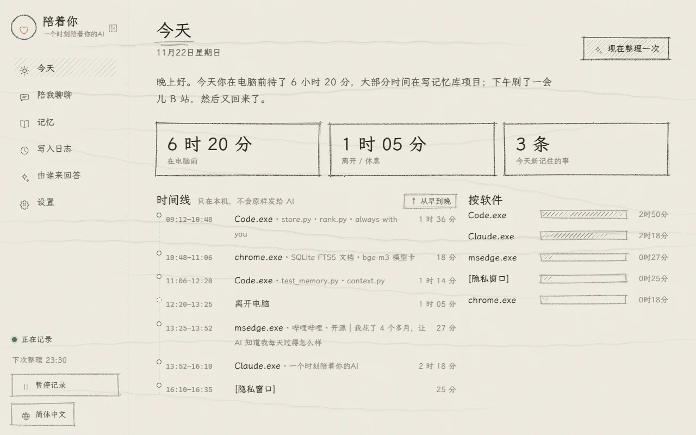
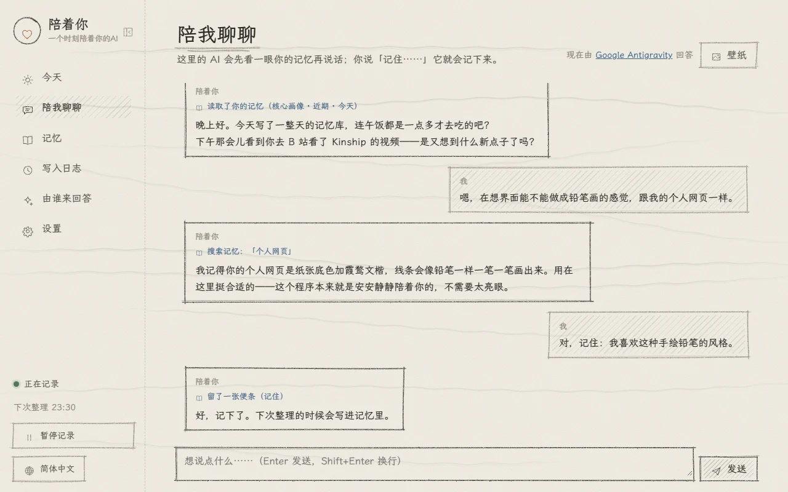
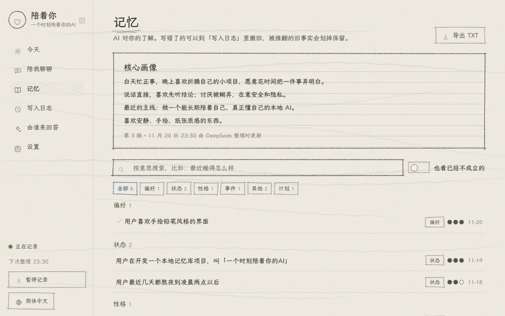
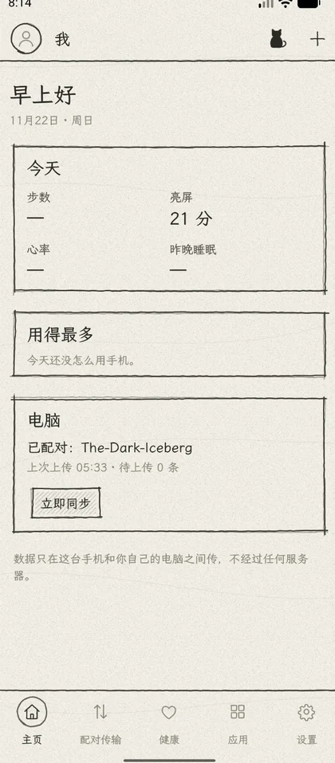
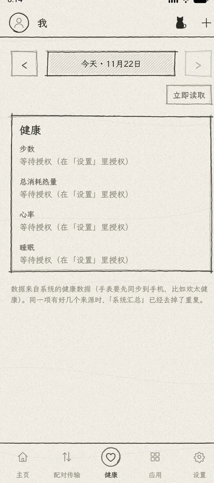
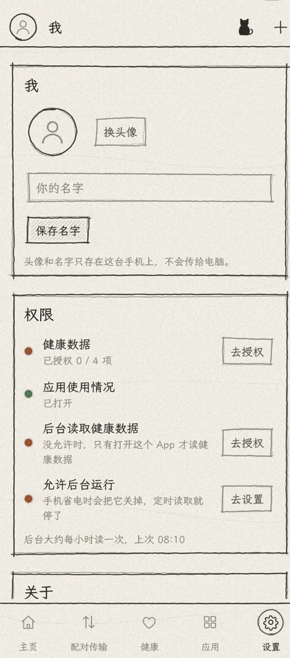
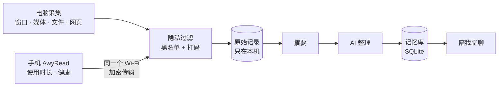

<div align="center">


# 一个时刻陪着你的AI

**Always With You** · 只在你自己电脑上运行的个人记忆库

记下你在电脑和手机上的一天 → 过滤隐私 → 让 AI 整理成「关于你的记忆」→ 想聊天时，它一开口就知道你最近怎么样。

    

[English](README.en.md) · **简体中文**

</div>

---

## 长什么样

<table>
<tr>
<td width="50%"><br><sub>今天：在电脑前做了什么（只在本机）</sub></td>
<td width="50%"><br><sub>陪我聊聊：先看一眼记忆再说话</sub></td>
</tr>
<tr>
<td colspan="2"><br><sub>记忆：核心画像和一条条事实，写错的可以撤回</sub></td>
</tr>
</table>

<p align="center">
&nbsp;
&nbsp;

<br><sub>手机端 AwyRead：主页 / 健康 / 设置（截图来自模拟器）</sub>
</p>

> 截图里的内容都是演示数据，不是真实记录。

## 它能做什么

| | |
|---|---|
| **记住** | 电脑：最前面的窗口、离开 / 睡眠、正在播放、最近打开的文件，装了浏览器扩展还有看过的网页。手机：每个 App 用了多久、亮屏时间、步数、心率、睡眠。 |
| **整理** | 每天几次，把这段时间的「摘要」交给 AI（DeepSeek 或订阅制 AI）整理成记忆：去重、发现矛盾、按重要程度和时间慢慢淡忘。每一次写入都有记录，写错了可以撤回。 |
| **陪你聊** | 「陪我聊聊」里的 AI 会先读你的记忆再说话；你说「记住……」它就记下来。 |
| **手机** | 手机端 AwyRead 在你和电脑连同一个 Wi-Fi 时，把手机上的一天加密传给电脑，一起整理。 |

## 怎么工作



AI 只看得到摘要和记忆，原始记录不出你的电脑。原理详见 [docs/原理说明.md](docs/原理说明.md)。

## 隐私

| | |
|---|---|
| **数据在哪** | 全部在你的电脑上（`%LOCALAPPDATA%\AlwaysWithYou`），可以在设置里搬到别处 |
| **不记什么** | 不录音、不截屏、不记键盘、不读剪贴板和通知、不用无障碍权限；手机端不读 App 里的内容、不读位置 |
| **自动隐藏** | 写进硬盘之前，密码、账号、手机号、证件号、银行卡、各种密钥换成「[已隐藏]」；黑名单里的软件只记成「隐私窗口」 |
| **交给 AI 的** | 只有整理好的摘要（比如「14:00–14:45 在 VS Code 写代码」），不交原始记录 |
| **手机传输** | 默认关着；只在同一个 Wi-Fi 里、只认真实网卡；配对码不上网，内容用 AES-GCM 加密 |

规则不是万能的，它认不出什么也写清楚了：[docs/SECURITY.md](docs/SECURITY.md)。

## 安装

**电脑（Windows）**

1. 运行安装包 `AlwaysWithYou-Setup-x.y.z.exe`。卸载在「设置 → 应用」里，会问要不要保留记忆。
2. 打开后右下角托盘出现角色图标，同时弹出主窗口。第一次会先让你看风险说明。
3. 「设置」里填 DeepSeek API Key；「由谁来回答」里选聊天用 DeepSeek 还是订阅制 AI。
4. （可选）「设置 → 其他」下载按意思搜索的模型（约 2.3GB）。

**手机（Android 14 及以上）**

1. 安装 `AwyRead.apk`，在「设置」里把健康数据、应用使用情况、后台运行几项打开。
2. 电脑上「设置 → 手机」打开接收，点「配对新手机」，把 12 位配对码填到手机的「配对传输」里。
3. 之后手机每小时读一次，和电脑连同一个 Wi-Fi 时自动传。

> 公司、学校这类 Wi-Fi 常常不让设备互相连接，这时在家里的 Wi-Fi 下配对，或者让手机连电脑开的「移动热点」。

完整说明：[docs/使用说明.md](docs/使用说明.md)

## 文档

| 文档 | 内容 |
|---|---|
| [原理说明](docs/原理说明.md) | 这个项目怎么做到的，重点是记忆系统 |
| [使用说明](docs/使用说明.md) | 安装、每个页面怎么用、常见问题 |
| [架构](docs/ARCHITECTURE.md) · [数据格式](docs/DATA_FORMAT.md) | 模块分工、数据怎么流动 |
| [记忆算法](docs/MEMORY_ALGORITHMS.md) | 检索、衰减、去重、整理规则 |
| [安全](docs/SECURITY.md) | 每一种风险和对策 |
| [路线图](docs/ROADMAP.md) · [设计决定](docs/decisions/README.md) | 做到哪了、为什么这么选 |

<details>
<summary><b>开发</b></summary>

先读 [AGENTS.md](AGENTS.md)（给接手的 AI 和人看的总入口）。

```bash
uv sync                                   # 安装依赖
uv run pytest -q                          # 跑全部测试
uv run python -m awy                      # 启动桌面程序（会用真实数据目录）
powershell -File packaging\build.ps1      # 打包电脑端安装包
powershell -File android\build.ps1        # 打包手机端 APK，见 android/README.md
```

- 界面：`ui/`（HTML/CSS/JS，铅笔手绘风格）；后台：`src/awy/`（Python）；手机端：`android/`（Kotlin，不用 Gradle、零第三方库）。
- 多语言：翻译在 `ui/i18n/<语言>.json`（键是中文原文），`tests/test_i18n.py` 会列出漏翻的句子。

</details>

## 许可证

代码用 [MIT 许可证](LICENSE)。不包括：霞鹜文楷字体（SIL OFL 1.1，授权文件随字体一起）、角色图（社区二创，作者不详，不在 MIT 范围内）。

## 致谢

- 字体：[霞鹜文楷](https://github.com/lxgw/LxgwWenKai-Screen)（SIL OFL 1.1）。
- 角色图：社区里大家给 Claude 画的二创涂鸦，作者不详。
